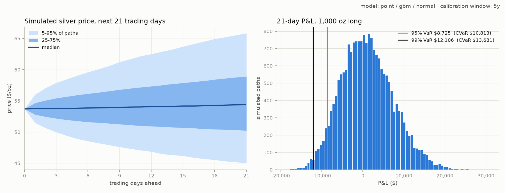
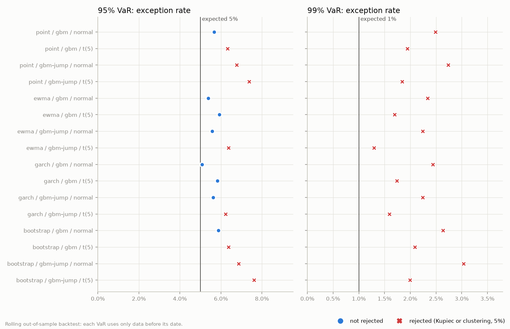
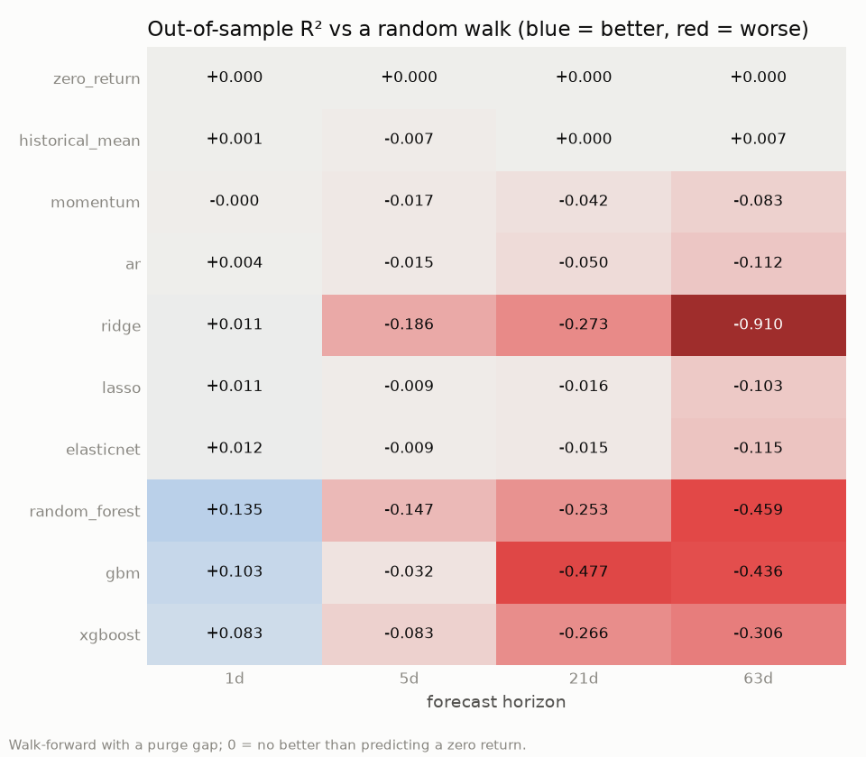

# Silver Quantitative Research: Risk, Forecasting & Option Pricing

A silver-price research project built around three different questions, kept in separate
modules because they need different tools:

1. **Risk** ([main.py](main.py), [risk_backtest.py](risk_backtest.py)) — how bad could a
   position get, and is the risk model actually calibrated? (Monte Carlo VaR/CVaR, rolling
   out-of-sample backtests)
2. **Forecasting** ([forecast_main.py](forecast_main.py), [forecast_robustness.py](forecast_robustness.py)) —
   is there any predictive signal for silver returns in gold, macro, or COT positioning data?
   (purged walk-forward ML, tested with Clark-West / Pesaran-Timmermann and multiple-testing corrections)
3. **Option pricing** ([option_main.py](option_main.py)) — what is an option on silver futures
   worth? (Black-76 closed form, cross-checked against risk-neutral Monte Carlo)

Both main findings are negative: no forecasting model beats a random walk once you correct for
how many were tried, and no variant of the risk model holds up at 99% out of sample.

## Results at a glance

All numbers are from data up to **2026-10-23** and can be reproduced exactly from the local
cache, or closely from a fresh download, by passing `--as-of 2026-10-23` to each script.

| | |
|---|---|
| Risk model, out of sample | **No variant passes a 1-day 99% VaR backtest** over 2016-2026: 1.3-3.0% of days breach vs 1% expected, across all 16 calibration × process × shock combinations |
| Best-calibrated at 95% | GARCH(1,1) + normal shocks: 5.08% exceptions vs 5% (Kupiec p=0.87) |
| 21-day VaR, 1,000 oz at $53.71 (flat 5y vol 40.6%) | 95%: $8,725 (16.2%) · 99%: $12,106 (22.5%) |
| Black-76, 63-day ATM call | **$4.05** (GARCH vol 38.2% averaged to expiry, r = 4.22%). Black-Scholes would say $4.36 (+7.6%) |
| Monte Carlo, 200k paths | $4.04; antithetic + control variate cut the standard error 4.6× (~21× fewer paths) |
| Forecasting, 21-day horizon | Only the historical-mean baseline beats a random walk: OOS R² +0.006 (5y), +0.0001 (10y). Every ML model is worse, and none is significant after Holm adjustment |
| Horizon / regime sweep | 0 of 36 testable (model, horizon) cells significant even before adjustment; one raw hit among 36 (model, regime) cells (p=0.03), which goes to p=0.85 after Benjamini-Hochberg |
| CFTC COT positioning | No stable value: dropping it helps 5 of 6 ML models (5y) and 4 of 6 (10y) |
| Trading the best model, 10y | +49% vs +333% buy-and-hold |







## Setup

Python 3.10+ (developed on 3.14).

```bash
python3 -m venv .venv
source .venv/bin/activate
pip install -r requirements.txt
```

XGBoost needs the OpenMP runtime on macOS, which isn't installed by default:

```bash
brew install libomp
```

No API keys required. Silver and gold prices come from Yahoo Finance (`yfinance`); real rates,
breakeven inflation, the dollar index, and the T-bill rate come from FRED's public CSV export;
CFTC Commitments-of-Traders positioning comes from the CFTC's public Socrata API. Downloads are
cached in `.cache/`, keyed by the as-of date. Delete that folder to force a fresh download.

```bash
pytest   # 59 offline tests on synthetic data, ~3s
```

## Project layout

| File | Role |
|---|---|
| [data.py](data.py) | Cached price downloads; volatility (EWMA, GARCH(1,1) with a horizon-averaged forecast), drift, block bootstrap, and jump detection |
| [monte_carlo.py](monte_carlo.py) | GBM path simulation: Student-t innovations, Merton jump-diffusion, antithetic variates |
| [risk_model.py](risk_model.py) | Turns a price history + model choice (calibration × process × shocks) into simulated paths; rolling forecaster for backtests |
| [risk.py](risk.py) | VaR / CVaR, Kupiec and Christoffersen tests, rolling out-of-sample VaR backtest in return space |
| [main.py](main.py) | CLI: simulate, plot a fan chart + P&L histogram, print risk metrics and the model's own backtest |
| [risk_backtest.py](risk_backtest.py) | CLI: backtest every risk-model variant side by side |
| [forecast_data.py](forecast_data.py) | Macro/gold/COT ingestion (FRED, yfinance, CFTC), each aligned to the date it was *published* |
| [features.py](features.py) | Raw levels → stationary features + a leakage-free N-day forward-return target |
| [forecast_model.py](forecast_model.py) | 10 models (4 baselines + 6 ML), purged walk-forward validation, economic backtest, coefficient stability, regimes |
| [significance.py](significance.py) | Clark-West, Pesaran-Timmermann, Bonferroni / Holm / Benjamini-Hochberg |
| [forecast_main.py](forecast_main.py) | CLI: all models at one horizon, economic significance, COT ablation + stability |
| [forecast_robustness.py](forecast_robustness.py) | CLI: sweep 1d/5d/21d/63d horizons and bull/bear/high-vol/low-vol regimes |
| [option_pricing.py](option_pricing.py) | Black-76 / Black-Scholes prices + Greeks; risk-neutral Monte Carlo with antithetic + control variates |
| [option_main.py](option_main.py) | CLI: price a silver futures option both ways from live inputs and check they agree |
| [plot_style.py](plot_style.py) | Shared figure styling |
| [tests/](tests) | Offline tests (pricing, estimation, backtests, significance tests, no-lookahead checks) |

## Usage

Every CLI takes `--as-of YYYY-MM-DD` to pin the data, and `--help` for the full flag list.

**Risk simulation**: Monte Carlo price paths, VaR/CVaR, and an out-of-sample backtest of the
chosen model:

```bash
python main.py --calibration garch --model gbm-jump --dist t --antithetic
```

**Risk model comparison**: rolling backtest of all 16 calibration × process × shock variants:

```bash
python risk_backtest.py --period 10y --plot docs/risk_backtest.png
```

**Forecasting, one horizon**: every model's out-of-sample performance against a random walk,
economic significance net of costs, and whether COT positioning helps:

```bash
python forecast_main.py --period 10y --horizon-days 21
```

**Forecasting, robustness sweep**: the same question across 4 horizons and 4 market regimes,
with multiple-testing adjustments:

```bash
python forecast_robustness.py --period 10y --plot docs/forecast_oos_r2.png
```

**Option pricing**: Black-76 vs Monte Carlo, using the front-month futures price, a GARCH vol
averaged to expiry, and the FRED 3-month T-bill rate by default:

```bash
python option_main.py --option-type put --strike 50 --maturity-days 90
```

## Key findings

### Risk model

- **Plain GBM understates daily tail risk**, out of sample: over 2016-2026 its 1-day 99% VaR
  is breached on 2.5% of days (50 of 2,009), not 1%.
- **Nothing tested fixes the 99% tail.** Across 4 calibrations (flat, EWMA, GARCH, block
  bootstrap) × 2 processes (GBM, Merton jumps) × 2 shock distributions (normal, Student-t), every
  variant is rejected at 99% ([risk_backtest.py](risk_backtest.py)). The pattern:
  - Conditional vol (EWMA, GARCH) brings the 95% level closest to target: 5.08% of days for
    GARCH + normal shocks and 5.38% for EWMA, vs 5.67% for flat vol.
  - Student-t shocks pull 99% exceptions down to 1.3-2.1%, but they over-breach at 95%. A
    unit-variance t is narrower in the shoulders than a normal.
  - Merton jumps make the 1-day VaR *worse*. Removing the jump days from the diffusion vol is
    correct (otherwise their variance is counted twice), but a jump arrives on only ~0.6% of days,
    too rarely to widen a 1-day 99% quantile.
- The 21-day VaR passes its backtest, but that test has almost no power: 5 years give only 35
  non-overlapping windows, so a correct model expects 0.35 exceptions at 99%. main.py prints
  both backtests and says so.
- Silver's worst day in the 5-year sample, 2026-01-30 at -31.35%, is a real historical event, not
  a futures-roll artifact. It was cross-checked against news coverage.

### Forecasting

- Ridge/Lasso/ElasticNet/Random Forest/GBM/XGBoost use gold, real rates, breakeven inflation,
  the dollar index, and CFTC COT positioning (Managed Money and Producer/Merchant net positions)
  as features. They are walk-forward validated on 21-day-forward silver log returns.
- **No model beats a random walk in a way that survives testing.** On 10 years (94
  non-overlapping test points), the only positive OOS R² is the historical-mean baseline at
  +0.0001. ML models range from -0.015 (ElasticNet) to -0.48 (GBM). No model reaches even a raw
  p<0.05 on Clark-West or Pesaran-Timmermann.
- **Accuracy above 50% isn't skill.** In a rising market, a mostly-long model beats a coin flip
  just by riding the base rate. The Pesaran-Timmermann test corrects for that, and with it no
  model shows directional skill.
- **COT positioning was ablation-tested** (each ML model with vs without it). Dropping it improved
  5 of 6 models on 5 years and 4 of 6 on 10 years. Lasso and ElasticNet mostly zero it out: across
  the walk-forward refits each COT coefficient keeps the same nonzero sign in only 1-26% of them.
- **Horizons and regimes** ([forecast_robustness.py](forecast_robustness.py)): 10 models × 4 horizons (1d/5d/21d/63d), plus a
  21-day slice by regime (bull/bear via the 200-day SMA, high/low realized vol). No (model, horizon)
  cell reaches a raw p<0.05 on either test. Among the regime cells, one does (XGBoost's direction
  in high-vol periods, p=0.03), which is about what chance predicts across 36 tests, and it goes
  to p=0.85 after Benjamini-Hochberg adjustment. The tree models' 1-day R² of +0.08 to +0.135 in
  the heatmap is a single day: one test point in the January 2026 crash (2026-01-26, followed by
  an 8.3% fall) provides 85-136% of their gain over the random walk. Without it, GBM and XGBoost
  are negative and random forest drops to +0.025. Directional accuracy at that horizon is 44-49%.
- **Conclusion**: this project found no exploitable forecasting signal for silver in gold, macro, or
  COT data at any horizon from 1 to 63 trading days, or in any bull/bear/vol regime tested.

### Option pricing

- `SI=F` is a futures price, so options on it are priced with **Black-76**, where the futures
  price has zero risk-neutral drift. Treating it as a spot price under Black-Scholes overprices a
  3-month ATM call by 7.6%.
- Closed-form prices and Greeks are tested against Hull's textbook example (S=K=100, r=5%, σ=20%,
  T=1y: call 10.4506) and put-call parity, and every Greek against finite differences, for
  both Black-76 and Black-Scholes.
- **The Monte Carlo pricer is unbiased and its standard errors are honest.** Across 400 seeds the
  mean pricing error is +0.000006 (z = 0.04), and 5.2% of runs fall outside their own 95%
  interval. At the default seed (42) it happens to land 2.0 standard errors away, one of those 5%
  runs, and the CLI says so. The test suite checks that each run's reported standard error matches
  the actual spread across runs, for every variance-reduction setting.
- Variance reduction at 200k paths: antithetic alone needs ~1.6× fewer paths for the same
  precision, the control variate ~4.8×, and both together ~21×.

## How the tests guard against fooling ourselves

- **No lookahead in features.** Every series is aligned to when it became public, not the date
  it describes: FRED daily yields one business day later, the weekly H.10 dollar index the
  Tuesday after its Monday release, and COT reports after their Friday release. Feature rows only
  see values at or before their date. A test checks that truncating the future leaves past
  features unchanged.
- **Purged walk-forward.** Each refit trains only on labels whose 21-day window ends before the
  test date, and Lasso/ElasticNet's internal cross-validation uses the same gap.
- **Independent test points.** Forecast targets and VaR windows never overlap, so the
  Clark-West, Pesaran-Timmermann, Kupiec, and Christoffersen tests all have the independent
  samples they assume.
- **Out-of-sample risk backtests in return space.** Each VaR is calibrated only on the 504
  trading days before its date, and exceptions are measured in % of position value, so a
  fixed-ounce position's P&L in years when silver was $20 isn't compared against today's
  dollar VaR.
- **Multiple comparisons.** With 40 (model, horizon) cells × 2 tests, a few raw p<0.05 hits are
  expected by chance. Results are reported after Holm and Benjamini-Hochberg adjustment.

## Corrections to earlier results

An earlier version of this README reported numbers that came from bugs, since fixed:

- The VaR backtest compared today's dollar VaR with dollar losses at old, much lower prices,
  and it was in-sample. It's now out-of-sample and in return space. The claim that bootstrap
  calibration + jumps "fixes" the tail did not survive this: see the risk findings above.
- Options on `SI=F` (a futures price) were priced with Black-Scholes instead of Black-76,
  overpricing a 3-month ATM call by about 7%.
- The Monte Carlo standard error treated antithetic pairs as independent draws, so the reported
  variance reduction was understated.
- Simulated paths drifted σ²/2 per year (about 8%) below their calibration history, because the
  mean log return was used as the arithmetic drift.
- Directional accuracy was tested against 50% rather than the base rate, and the COT
  "sign stability" check was run on tree importances, which can't change sign.

## Known limitations

- `SI=F` is Yahoo's front-month continuous contract with no roll adjustment, so roll dates add
  small artificial returns. Listed silver options are on a specific contract month.
- The option pricer uses a GARCH forecast as a stand-in for implied vol; there is no options
  chain wired in.
- The Student-t degrees of freedom (5) and the jump-detection threshold (4 local std devs) are
  fixed rather than estimated.
- COT publication delays shift by a day in holiday weeks; the alignment uses the normal schedule.
